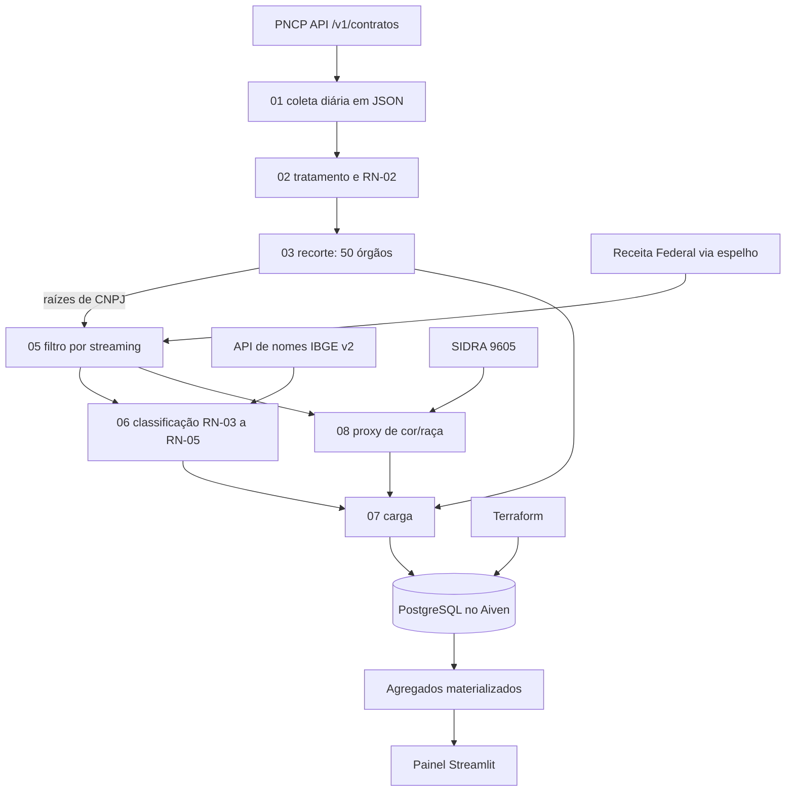

# Fornecedores societários: quem está por trás dos CNPJs que recebem dinheiro público

Trabalho de Big Data e Analytics, tema 9 (contratações públicas e fornecedores societários).
Grupo: Afonso de Menezes Alves Neto, Ana Júlia Gusmão do Nascimento, Iago César Lacerda Santos, Pedro Lucas Felix Aragão.

## Sumário
1. Problema e recorte
2. LGPD
3. Os 5 V's
4. Tipos de dado e fontes
5. Arquitetura e infraestrutura
6. Modelo de dados
7. Regras de negócio e testes
8. Redução de volume
9. Limitações
10. Fontes e como reproduzir

---

## 1. Problema e recorte

**Pergunta central:** quem são as pessoas por trás dos CNPJs que recebem dinheiro público, e há assimetria de gênero e de cor/raça nesse controle?

| Pergunta | Enunciado |
|---|---|
| Q1 | Há assimetria de gênero na captura de recurso público por fornecedores? |
| Q2 | Que leitura interseccional surge ao cruzar gênero do controle com cor/raça (proxy territorial)? |
| Q3 | Quão concentrado é o controle societário dos fornecedores? |

**Recorte.** Contratos publicados no PNCP entre 01/01/2025 e 31/12/2025 (endpoint `/v1/contratos`), limitados aos 50 órgãos com maior valor contratado após o filtro de valor (RN-02). Os CNPJs dos fornecedores desses contratos (pela raiz de 8 dígitos) são cruzados com o quadro societário da Receita Federal.

**Funil.**

| Etapa | Base parcial | Final |
|---|---|---|
| Contratos coletados | [PREENCHER] | [PREENCHER] |
| Após RN-02 | [PREENCHER] | [PREENCHER] |
| Após recorte dos 50 órgãos | [PREENCHER] | [PREENCHER] |
| Raízes de CNPJ distintas no recorte | 10.366 | [PREENCHER] |
| Linhas em `fato_contrato` | 33.672 (simulação) | [PREENCHER] |
| Contratos com fornecedor PF ou estrangeiro (raiz nula) | 2.769 | [PREENCHER] |

**Por que 50 órgãos.** Na base parcial, os 50 maiores órgãos concentram 58,2% do valor elegível com apenas 7,3% dos contratos. O recorte mantém a maior parte do dinheiro e cabe no plano gratuito do banco (seção 5).

---

## 2. LGPD

Parecer completo em `docs/lgpd.md`. Resumo:

- **Base:** dados públicos (PNCP e Receita Federal), uso acadêmico, finalidade estatística.
- **Minimização:** o banco não recebe nome de sócio nem CPF. O nome só existe em memória durante o script de classificação. O sócio é identificado por um hash (SHA-256 de `ID_SALT` + máscara do CPF + nome completo normalizado, truncado em 16 caracteres). O sal fica no `.env`, nunca no Git.
- **Gênero** é inferido do primeiro nome (RN-04) e guardado só como categoria (F, M, I) com a confiança.
- **Cor/raça individual não existe no projeto.** Só há proxy territorial (percentual do município). Nenhuma análise atribui cor/raça a uma pessoa.
- **Empresário individual:** a razão social, que contém o nome da pessoa, é substituída por texto genérico no banco.
- **Mínimo de 5 por recorte** nos painéis, para evitar reidentificação (RN-09).
- **Cruzamento com o TSE foi rejeitado**, por permitir ligar nome a cor/raça autodeclarada de pessoas reais.
- Arquivos intermediários com nomes de sócios existem apenas em `data/` local, fora do Git.
- Testes automáticos conferem que os arquivos de saída não têm coluna de nome ou CPF nem valores com formato de CPF (seção 7.3).

---

## 3. Os 5 V's

| V | Evidência |
|---|---|
| **Volume** | Receita: 37 arquivos ZIP, 7,76 GB compactados (Estabelecimentos 5,38; Empresas 1,38; Sócios 0,69; Simples 0,31; domínios menos de 0,01). PNCP: 1,08 GB de JSON em 137 dias. O filtro leu 171,8 milhões de linhas. |
| **Velocidade** | Coleta diária, retomável, a cerca de 1,4 a 1,5 dia de dados por minuto. Filtro da Receita: 171,8 milhões de linhas em cerca de 4 minutos, por streaming. Atualização agendada: [PREENCHER: workflow do GitHub Actions]. |
| **Variedade** | JSON (PNCP), ZIP com CSV (Receita), JSON de API (nomes IBGE), séries tabulares (SIDRA), texto livre (objeto do contrato). |
| **Veracidade** | Contratos de receita, valores absurdos e assinaturas fora de 2025 são excluídos (RN-02). Gênero tem limiar de confiança. A cobertura de sócios é medida (88,5% das raízes na base parcial). As regras têm testes automáticos. Limitações na seção 9. |
| **Valor** | [PREENCHER: achados de Q1, Q2 e Q3 com os números finais] |

---

## 4. Tipos de dado e fontes

### 4.1 Tipos de dado

| Tipo | Fonte | Exemplos |
|---|---|---|
| Semiestruturado | PNCP, `/v1/contratos` (41 campos, 21 lidos) | `numero_controle_pncp`, `orgao_cnpj`, `valor_global`, `data_assinatura` |
| Estruturado (tabular, delimitado) | Receita Federal, CNPJ (Empresas, Estabelecimentos, Sócios, domínios) | `cnpj_basico`, `natureza_juridica`, `qualificacao_socio` |
| Estruturado (API) | IBGE nomes v2; SIDRA 9605 | frequência por nome; população por cor/raça e município |
| Não estruturado | Campo `objeto_contrato` do PNCP | descrição livre do que foi contratado (truncada em 500 caracteres no banco) |

Colunas usadas, descartadas e a descrição de cada saída estão em `docs/mapa_colunas.md`.

### 4.2 Receita Federal

A URL oficial (`dadosabertos.rfb.gov.br`) estava inacessível durante o trabalho. Foi usado o espelho da Casa dos Dados (`dados-abertos-rf-cnpj.casadosdados.com.br`), que republica os arquivos da Receita. Competência: arquivos com data de 18/09/2026 [CONFIRMAR o mês em `RECEITA_URL`].

O inventário foi feito por streaming, sem baixar os ZIP inteiros (`docs/inventario_receita.xlsx`).

### 4.3 Fontes complementares

- **Gênero:** API de nomes do IBGE v2 (Censo 2010), documentada e estável. A v3 (Censo 2022) não consta da documentação pública. As respostas ficam em cache local (`data/interim/cache_nomes_ibge.json`), então cada nome é consultado uma só vez.
- **Proxy territorial de cor/raça:** SIDRA, tabela 9605 (Censo 2022), variável 93 (população residente, em pessoas), classificação 86 (cor ou raça), nível município. Foram feitas 27 chamadas (uma por UF), com 5.570 municípios e 203.080.756 pessoas, todos com valor. No país, pretos e pardos somam 55,5% e brancos 43,5%. Calculamos o percentual de cada categoria e `pct_negra` (preta + parda).
- **Tradução de município:** o código da Receita (4 dígitos) difere do código do IBGE (7 dígitos). A ligação usa nome normalizado e UF: 5.524 de 5.541 pares (99,7%) foram traduzidos, cobrindo 99,8% dos estabelecimentos.

### 4.4 Piloto de gênero

1.000 sócios PF sorteados (semente 42) das primeiras 200 mil linhas de `Socios0`, com 538 nomes distintos.

| Resultado | % |
|---|---|
| Feminino | 37,2 |
| Masculino | 57,2 |
| Ambíguo | 2,1 |
| Nome ausente | 3,5 |

Sensibilidade ao limiar de confiança (indeterminados): 80% → 4,6%; **90% → 5,6%**; 95% → 6,3%; 99% → 9,6%. O limiar de 90% foi mantido. O piloto da 1ª Unidade, que usou o Censo 2022 em outro arquivo, deu 3,7% a 90%. A diferença de 1,9 ponto não separa efeito da fonte de efeito da amostra, e fica declarada como limitação.

### 4.5 Classificação na base parcial

17.403 sócios PF, 3.660 nomes distintos.

| Gênero | % |
|---|---|
| Masculino | 64,1 |
| Feminino | 31,5 |
| Indeterminado (ambíguo) | 1,0 |
| Nome ausente | 3,4 |

Classificação do controle das 10.366 empresas (RN-03 padrão):

| Classe | % |
|---|---|
| Masculino | 43,4 |
| Feminino | 20,5 |
| Misto sem maioria | 11,6 |
| Misto com sócio PJ | 8,7 |
| Misto por mais de 1/3 indeterminados | 4,3 |
| Sem sócio elegível | 11,5 |

Controle definido em 63,9% das empresas, e 32,1% delas são femininas.

**Sensibilidade (RN-03 estrita).** A versão estrita deixa de contar as qualificações Diretor, Presidente, Conselheiro e a qualificação exatamente "Administrador". O **Sócio-Administrador continua contando**, porque é sócio. Com ela, o controle definido cai para 58,2% e as femininas sobem para 33,8%. [ATUALIZAR com a base final]

---

## 5. Arquitetura e infraestrutura

### 5.1 Infraestrutura como código

O serviço `pg-fornecedores` é criado por Terraform (`terraform/`), no Aiven, plano `free-1-1gb`, projeto `ucsal-66ba`. O schema com 9 tabelas é aplicado por `etl/aplicar_schema.py`.

    cd terraform
    copy terraform.tfvars.example terraform.tfvars    # edite project_name
    terraform init
    terraform apply

O reprovisionamento foi comprovado em clone limpo (`docs/terraform_apply_maquina_limpa.txt` e `docs/img/aiven_running_maquina_limpa.png`). A primeira instância está em `docs/terraform_apply.txt`, `docs/terraform_state.txt` e `docs/img/aiven_running.png`.

### 5.2 Limites do plano gratuito

- 1 GB de disco (o plano free era de 5 GB até 15/05/2025).
- 20 conexões.
- O serviço é desligado por inatividade. É preciso religá-lo antes da carga e da apresentação.
- Um único PostgreSQL gratuito por organização.
- Orçamento do projeto: banco com no máximo 600 MB, medido ao fim da carga.

### 5.3 Segredos

`terraform.tfvars`, `.env`, `data/` e `*.tfstate` estão no `.gitignore`. O token do Aiven vai por variável de ambiente `TF_VAR_aiven_api_token` [CONFERIR o nome em `variables.tf`]. O `.env` guarda `DATABASE_URL` e `ID_SALT`.

### 5.4 Problemas encontrados e resolvidos

| Problema | Causa | Solução |
|---|---|---|
| 401 no Terraform | token copiado errado; depois, variável de ambiente ausente no terminal | recriar o token e definir a variável na sessão |
| 403 ao criar o serviço | a organização já tinha um PostgreSQL gratuito | destruir o serviço antigo |
| 404 no clone limpo | `project_name` com o texto de exemplo | editar `terraform.tfvars` |
| URL oficial da Receita fora do ar | indisponibilidade | espelho declarado |
| Códigos de município diferentes entre Receita e IBGE | tabelas de códigos distintas | tradução por nome normalizado e UF (99,7% dos pares) |

---

## 6. Modelo de dados

Modelo estrela com 9 tabelas, definido em `etl/sql/schema.sql`.

| Tabela | Papel | Linhas (simulação parcial) |
|---|---|---|
| `fato_contrato` | um contrato por linha, com valor, prazo e objeto | 33.672 |
| `dim_tempo` | calendário diário (`yyyymmdd`) | 365 |
| `dim_orgao` | órgão contratante | 50 |
| `dim_fornecedor` | raiz de CNPJ, porte, natureza, UF, município e classificação do controle | 10.366 |
| `dim_socio` | sócio por hash, tipo, gênero e confiança | 18.092 |
| `ponte_empresa_socio` | relação N:N entre empresa e sócio, com `elegivel` | 18.771 |
| `dim_municipio` | os 5.570 municípios, com população e `pct_negra` | [PREENCHER após a carga] |
| `dim_cnae` | atividade econômica | 1.359 |
| `dim_modalidade` | tipo de contrato e categoria do processo | 46 |

Decisões do modelo:

- `dim_modalidade` combina tipo de contrato e categoria do processo, porque a modalidade real da licitação está na compra, que não foi coletada.
- A ponte é necessária porque um sócio pode estar em várias empresas e uma empresa tem vários sócios.
- `fato_contrato` mantém fornecedor PF ou estrangeiro com `cnpj_raiz_fornecedor` nulo, para não perder valor.
- `dim_municipio` recebe todos os municípios do Censo 2022, e não só os que aparecem nos contratos, para que o proxy racial esteja disponível a qualquer cruzamento.
- `dim_fornecedor.codigo_ibge` vem da tradução município da Receita → IBGE (seção 4.3), o que liga o fornecedor ao proxy racial. Fornecedores sem tradução ficam com o campo nulo e fora do KPI 3.
- `dim_cnae.pct_negra_setor` e `pct_mulher_setor` (proxy setorial, RAIS ou CAGED) existem no schema e hoje ficam vazios [PREENCHER ou remover].
- `sancionado_na_assinatura` (RN-08) existe no schema e hoje é sempre falso [PREENCHER ou remover].
- Os `CHECK` do schema (`tipo`, `genero`, `classificacao_controle`) são verificados antes da carga pelos testes da seção 7.3.

**Orçamento de armazenamento:** o banco inteiro deve ficar abaixo de 600 MB. Tamanho final medido: [PREENCHER após a carga].

---

## 7. Regras de negócio e testes

### 7.1 Regras

| Regra | Descrição | Estado |
|---|---|---|
| RN-01 | O fornecedor é identificado pela raiz do CNPJ (8 dígitos). | implementada e testada |
| RN-02 | Exclui contratos de receita; mantém `valor_global` > 0 e ≤ R$ 1 bi; exige assinatura em 2025. | implementada e testada |
| RN-03 | Define o sócio elegível (detalhe abaixo). | implementada e testada |
| RN-04 | Gênero pelo primeiro nome, API v2 do IBGE, limiar de 90% (abaixo disso, indeterminado). | implementada e testada |
| RN-05 | Classifica o controle da empresa (detalhe abaixo). | implementada e testada |
| RN-06 | Proxy territorial de cor/raça (percentuais do município, Censo 2022). | gerado pelo `08`; carga em `dim_municipio` pelo `07` |
| RN-07 | Concentração societária. | Fase 2 |
| RN-08 | Marca contratos com empresa sancionada (CEIS e CNEP) na assinatura. | não implementada |
| RN-09 | Minimização de dados e mínimo de 5 por recorte nos painéis. | minimização implementada e testada; mínimo de 5 no painel: Fase 2 |

**RN-02 (base parcial; atualizar com a base final).**

- **Receita:** 5.175 contratos (0,9%) são de receita (no PNCP, `receita = True` é receita e `False` é despesa) e saem do recorte.
- **Valor máximo:** 87 contratos acima de R$ 1 bi somam R$ 5,87 tri, 96,6% do valor bruto, e são tratados como erro de digitação provável.
- **Ano de assinatura:** 102.546 contratos publicados em 2025 foram assinados em 2024 e saem do recorte.
- **Anulados e cancelados** não podem ser excluídos, porque o endpoint não traz a situação do contrato.

**RN-03: quem conta como sócio.**

- Só pessoa física (PF) é elegível. Sócios PJ e estrangeiros (ES) nunca são.
- Não contam as qualificações de representação: procurador, representante, inventariante, liquidante, interventor, tutor, curador, mãe e pai.
- Regra padrão: administradores, diretores, presidentes e conselheiros contam.
- Regra estrita (`--excluir-administradores`, usada como sensibilidade): saem também Diretor, Presidente, Conselheiro e a qualificação exatamente "Administrador". O Sócio-Administrador continua contando.
- Vínculos repetidos (mesmo sócio, empresa e qualificação) são removidos.

**RN-05: classificação do controle da empresa**, nesta ordem de decisão (a primeira condição verdadeira vence):

| Ordem | Condição | Classe |
|---|---|---|
| 1 | a empresa tem algum sócio PJ no quadro (elegível ou não) | misto/indeterminado, motivo "sócio PJ" |
| 2 | nenhum sócio elegível | sem sócio elegível |
| 3 | mais de 1/3 dos elegíveis com gênero indeterminado | misto/indeterminado |
| 4 | mais da metade dos elegíveis são mulheres | feminino |
| 5 | mais da metade dos elegíveis são homens | masculino |
| 6 | nenhum dos anteriores (por exemplo, empate) | misto/indeterminado, "sem maioria" |

A ordem importa: uma empresa só com sócio PJ é "misto com sócio PJ", e não "sem sócio elegível". O `pct_indeterminados` da empresa é a parte de indeterminados entre os elegíveis.

**Concentração de valor no recorte parcial.**

| Contratos acima de | Quantidade | Parte do valor |
|---|---|---|
| R$ 10 mi | 969 | 90,8% |
| R$ 100 mi | 179 | 63,2% |
| R$ 500 mi | 43 | 31,7% |

Por isso, os KPIs de valor usam a mediana e são apresentados com e sem contratos acima de R$ 100 mi, e a concentração é reportada como achado. [CONFIRMAR com o grupo]

### 7.2 Decisão pendente

A regra padrão (administradores contam) segue o roteiro da disciplina e é a principal. A estrita é sensibilidade. [CONFIRMAR com o grupo]

### 7.3 Testes automáticos

    pip install pytest
    python -m pytest tests -v

| Arquivo | O que verifica | Resultado |
|---|---|---|
| `tests/test_regras.py` | 31 testes de dados sobre os Parquet gerados: RN-01 a RN-05 recalculadas a partir dos vínculos, compatibilidade com os `CHECK` do schema, unicidade das chaves da ponte, ausência de nome e CPF (RN-09) | 31 passaram em 20/11/2026 (base parcial) |
| `tests/test_unitarios.py` | 39 testes de `genero.py` e do `06` com dados sintéticos: limiar de 90% (inclusivo), cache, qualificações de RN-03, ordem de decisão da RN-05 e inversão do controle na regra estrita | 39 passaram em 20/11/2026 |

A saída completa está em `docs/testes_regras.txt`. Os testes de dados são rodados de novo no congelamento do código (23/11/2026), com a base final.
No total, são 70 testes passando em 20/11/2026.

---

## 8. Redução de volume

| Etapa | Antes | Depois |
|---|---|---|
| Receita, arquivos compactados | 7,76 GB | 7,45 GB lidos nos 3 grupos usados |
| Receita, linhas | 171,8 milhões lidas | 130.727 mantidas (0,076%) |
| Receita, descompactado | [PREENCHER do `--consolidar`] | [PREENCHER] |
| Receita, Parquet final | | [PREENCHER] |
| Fator de redução | | [PREENCHER] |
| PNCP, JSON bruto | 1,08 GB (137 dias) | 101,8 MB em Parquet tratado |
| Recorte de contratos | | 5,6 MB (base parcial) |
| Proxy racial (SIDRA) | 27 chamadas de API | 5.570 municípios em um Parquet |
| Banco no Aiven | | [PREENCHER] |

Linhas mantidas da Receita: Sócios 18.771, Empresas 10.366, Estabelecimentos 101.590. Cobertura: Empresas 100%, Estabelecimentos 100%, Sócios 88,5% (9.172 raízes com sócio e 1.194 sem).

A redução vem do filtro por streaming (`stream_unzip`): o arquivo bruto nunca é gravado em disco.

---

## 9. Limitações

- **Borda direita:** a coleta é por data de publicação, então contratos assinados no fim de 2025 e publicados depois podem faltar.
- **Base parcial:** os números marcados acima ainda não refletem os 365 dias.
- **Sem situação do contrato:** anulados e cancelados não são identificáveis.
- **Valores concentrados:** poucos contratos dominam o valor total (seção 7).
- **Valor global x parcela:** `valor_global` é o valor total contratado, não o pago, e não é acumulado por ano.
- **Fornecedor PF ou estrangeiro:** não tem CNPJ e fica fora da análise societária.
- **Cobertura de sócios:** 11,5% das raízes (base parcial) não têm sócio elegível. Entre elas, 984 são empresários individuais (natureza 2135), sem quadro societário na Receita.
- **Gênero:** inferido do primeiro nome e sujeito a erro. Quem tem nome ambíguo ou ausente é indeterminado. A base do IBGE é o Censo 2010. A diferença de 1,9 ponto contra o piloto da 1ª Unidade não foi explicada.
- **Administradores:** somam 4.391 vínculos (25,2%) e entram como controle na regra padrão. A regra estrita está como sensibilidade.
- **Sócio PJ:** qualquer sócio PJ no quadro torna o controle "misto", mesmo que os sócios PF sejam maioria. Isso reduz o controle definido (8,7% das empresas na base parcial).
- **Cor/raça é proxy ecológico.** O percentual descreve o município do estabelecimento, não o sócio. Qualquer leitura individual seria falácia ecológica.
- **Tradução de município:** 17 pares (0,2% dos estabelecimentos) não foram traduzidos para o código IBGE, aparentemente por diferença de grafia, e ficam fora do KPI 3.
- **Fonte espelho:** a Receita foi lida de um espelho, não do portal oficial.
- **Plano gratuito:** 1 GB e desligamento por inatividade limitam o recorte e a disponibilidade.

---

## 10. Fontes e como reproduzir

### Fontes

| Fonte | Endereço | Acesso |
|---|---|---|
| PNCP, contratos | API `/v1/contratos` | [PREENCHER data] |
| Receita Federal, CNPJ | espelho da Casa dos Dados (competência [CONFIRMAR]) | [PREENCHER data] |
| IBGE, API de nomes v2 | `servicodados.ibge.gov.br/api/v2/censos/nomes` | [PREENCHER data] |
| IBGE, SIDRA tabela 9605 | `servicodados.ibge.gov.br/api/v3/agregados/9605` | 20/11/2026 |

### Estrutura do repositório

    terraform/   infraestrutura (main, variables, outputs, tfvars de exemplo)
    etl/         scripts numerados e módulos (config, receita_stream, genero)
    etl/sql/     schema, índices e orçamento
    tests/       testes de dados e unitários (pytest)
    docs/        README auxiliar, lgpd, mapa de colunas, evidências, diagramas
    data/        raw, interim e processed (fora do Git)

### Passos

1. `terraform apply` (seção 5.1).
2. `python etl/aplicar_schema.py`
3. `python etl/00_inventario_receita.py` e `python etl/00b_planilha_inventario.py`
4. `python etl/01_coletar_pncp.py` (diário, retomável)
5. `python etl/02_tratar_contratos.py`
6. `python etl/03_recorte_cnpjs.py`
7. `python etl/02b_diagnostico.py`
8. `python etl/05_filtrar_receita.py --refazer` e depois `--consolidar`
9. `python etl/06_classificar_empresas.py` (e, para a sensibilidade, `--excluir-administradores`)
10. `python etl/08_proxy_racial.py` (depois do passo 8)
11. `python -m pytest tests -v`
12. `python etl/07_carregar_aiven.py --simular`, depois `python etl/07_carregar_aiven.py` (ou `--recarregar`)
13. [PREENCHER: agregados materializados e painel Streamlit]

Scripts auxiliares: `04_piloto_genero.py` (piloto da seção 4.4) e `t3_checar_fontes.py` (checagem das fontes).