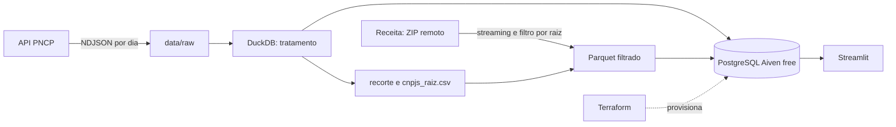

# Contratações Públicas e Fornecedores Societários

Big Data e Analytics, projeto prático, tema 9.
Grupo: Afonso de Menezes Alves Neto, Ana Júlia Gusmão do Nascimento, Iago César Lacerda Santos, Pedro Lucas Felix Aragão.

Pergunta central: **quem são as pessoas por trás dos CNPJs que recebem dinheiro público, e há assimetria de gênero e de cor/raça nesse controle?**

## 1. Problema, perguntas analíticas e recorte

- **Q1** Assimetria de gênero: participação de empresas de controle feminino no valor contratado e no número de contratos.
- **Q3** Concentração societária: quantos sócios (pessoas, não CNPJs) concentram o valor contratado; sócios em comum; vínculo com sancionados (CEIS/CNEP).
- **Q2** Camada interseccional: gênero do controle cruzado com composição de cor/raça por proxy setorial e territorial.

**Recorte:** contratos do PNCP assinados em 2025 (01/01/2025 a 31/12/2025), coletados dia a dia pela API de consulta.
Filtros previstos: valor global maior que zero e até R$ 1 bilhão (acima disso, erro de digitação) e os 50 órgãos de maior valor contratado.
`[PREENCHER na Fase 2: justificativa final do recorte por órgão e números do funil]`

## 2. LGPD e dados abertos

Resumo (texto completo em `docs/lgpd.md`):
- Contratos e quadro societário são dados públicos (Lei 12.527/2011 e Decreto 8.777/2016).
- Nome de sócio é dado pessoal mesmo sendo público: o CPF nunca é armazenado e o nome é substituído por identificador derivado antes de qualquer exibição. O painel só publica agregados com no mínimo 5 sócios ou empresas por recorte (RN-09).
- Cor/raça é dado sensível (LGPD, art. 5º, II): não é inferida por pessoa, só por proxy ecológico (setor e município) atribuído ao contexto da empresa (RN-06).
- **Caminho rejeitado:** cruzar nome de sócio com bases de cor/raça autodeclarada (por exemplo candidaturas do TSE) seria reidentificação de dado sensível.
- Minimização na ingestão: e-mail, telefones, endereço, CEP, nome do representante legal e país do sócio são descartados (o e-mail vem preenchido em 99,14% dos estabelecimentos da amostra).

## 3. Os 5 V's (números reais)

| V | Número medido | Decisão do pipeline |
|---|---|---|
| Volume | Receita: 7,76 GB compactado em 37 ZIP (Estabelecimentos 5,38; Empresas 1,38; Sócios 0,69; Simples 0,31; domínio menos de 0,01). PNCP 2025: `[PREENCHER: registros e GB brutos]` | leitura em streaming e filtro por raiz de CNPJ; Postgres recebe só o recorte |
| Velocidade | PNCP publica contratos diariamente; coleta incremental, retomável, um arquivo por dia. Receita atualiza mensalmente. `[PREENCHER: workflow do GitHub Actions]` | ingestão em lote agendada |
| Variedade | CSV (Receita), JSON aninhado (PNCP) e texto livre (`objetoContrato`) | DuckDB para JSON, Parquet para a camada analítica |
| Veracidade | 18 duplicatas em 200 mil linhas de sócios; 166.980 máscaras de CPF distintas contra 192.299 pares máscara+nome (usar só a máscara fundiria cerca de 13,2% das identidades) | deduplicação por chave natural; identificador do sócio = máscara + nome |
| Valor | `[PREENCHER: achados da Fase 2]` | KPIs do painel |

Amostras de sócios e estabelecimentos são sequenciais (primeiras 200 mil linhas de um arquivo), não aleatórias.

## 4. Tipos de dado

| Variedade | Fonte | Exemplo |
|---|---|---|
| Estruturado | CSV da Receita (`;`, sem cabeçalho, latin-1): sócios, empresas, estabelecimentos | `[PREENCHER: 2 linhas de Sócios com nome mascarado]` |
| Semi-estruturado | JSON do PNCP com campos aninhados (`orgaoEntidade`, `unidadeOrgao`); JSON das APIs do IBGE | `[PREENCHER: um contrato do PNCP, PJ]` |
| Não estruturado | campo `objetoContrato` (texto livre em português) | `[PREENCHER: um objeto de contrato]` |

## 5. Arquitetura, Terraform e segredos

- **Infraestrutura como código:** `terraform/` (`main.tf`, `variables.tf`, `outputs.tf`) cria o serviço PostgreSQL no Aiven. Provider `aiven/aiven` versão 4.x (versão fixada em `.terraform.lock.hcl`), plano `free-1-1gb`.
- **Limites do plano free:** 1 CPU, 1 GB de RAM, 1 GB de disco, máximo de 20 conexões, um serviço free por organização, desligamento por inatividade.
- **Segredos:** o token do Aiven entra só por variável de ambiente (`TF_VAR_aiven_api_token`), sem valor padrão no código. A `DATABASE_URL` fica no `.env`. O `.gitignore` cobre `.env`, `*.tfstate`, `*.tfstate.*`, `.terraform/` e `*.tfvars` (o repositório tem só `.example`). O `tfstate` guarda credenciais em texto claro e nunca é versionado.
- **Problemas encontrados (e resolvidos):** o plano free passou de 5 GB para 1 GB, então o nome do plano mudou e o valor antigo era inválido; erro 401 por token copiado errado; erro 403 porque a organização já tinha um PostgreSQL free (o limite é 1), resolvido liberando o serviço antigo antes do `apply`.
- **Evidência:** `[PREENCHER: print do console com o serviço Running em docs/img/ e saída de terraform state list]`

## 6. Modelo de dados e por que relacional

Modelo estrela com 9 tabelas (`etl/sql/schema.sql`): `fato_contrato` (grão: um contrato) e as dimensões `dim_orgao`, `dim_fornecedor`, `dim_tempo`, `dim_cnae`, `dim_municipio`, `dim_modalidade`, `dim_socio`, mais a tabela ponte `ponte_empresa_socio`.

A relação empresa-sócio é muitos-para-muitos (um sócio em várias empresas, uma empresa com vários sócios), por isso ela não cabe numa dimensão comum e precisa da ponte. É ela que permite o agregado de gênero por empresa e a análise de rede.

**Por que relacional:** a análise é feita de junções entre entidades bem definidas, com cardinalidade conhecida, e o modelo estrela responde às agregações do painel com índice em poucas colunas. O não relacional entra só onde o dado é texto sem esquema fixo (`objetoContrato`, camada opcional).

Os índices ficam em `etl/sql/indices.sql` e são criados depois das cargas.

**Orçamento de armazenamento (1 GB):**

| Camada | Onde fica |
|---|---|
| Receita bruta (37 ZIP) | nunca em disco; lida por streaming |
| Contratos tratados do ano | Parquet local (DuckDB), fora do banco |
| Receita filtrada | Parquet local; no banco só `dim_fornecedor`, `dim_socio`, `ponte` |
| `fato_contrato` | só o recorte; `objeto_contrato` truncado em 500 caracteres |
| Agregados do painel | materializados no banco |

Regra: o banco não passa de 600 MB, medido com `etl/sql/budget.sql` após cada carga. `[PREENCHER: tamanho medido por tabela]`

## 7. Regras de negócio

RN-01 normalização de identificadores · RN-02 elegibilidade do contrato · RN-03 sócio com poder de controle · RN-04 inferência de gênero (limiar de 90%) · RN-05 classificação de controle da empresa · RN-06 proxy de cor/raça · RN-07 concentração societária · RN-08 marcação de sanção · RN-09 anonimização e mínimo de agregação.
`[PREENCHER na Fase 2: enunciado, justificativa e teste de cada regra]`

## 8. Redução de volume

| Etapa | Volume |
|---|---|
| Receita, bruto (37 ZIP) | 7,76 GB compactado (medido) |
| Receita descompactada | `[PREENCHER: medir no filtro]` |
| Receita após o filtro (Parquet) | `[PREENCHER]` |
| Redução | `[PREENCHER]` |

## 9. Achados e limitações

Limitações já conhecidas:
- Amostras de inventário são sequenciais. Dois arquivos da mesma base deram perfis diferentes (Estabelecimentos0: 50,11% ativa e 44,25% baixada; no inventário anterior, Estabelecimentos1: 15,6% e 63,1%): os percentuais valem só para as linhas lidas.
- O quadro societário da Receita é o de hoje; os contratos são de 2025.
- Contagem de gênero por cabeça, porque o percentual de participação não consta dos dados abertos.
- Cor/raça por inferência ecológica (setor e município), nunca por pessoa.
- Os arquivos da Receita foram baixados de um espelho (ver seção 10).

`[PREENCHER na Fase 2: achados com número]`

## 10. Reprodução

Fontes e datas de acesso:
- **PNCP:** `https://pncp.gov.br/api/consulta/v1/contratos`, acessado em `[PREENCHER: período de coleta]`.
- **Receita Federal, dados abertos do CNPJ**, competência `[PREENCHER: AAAA-MM]`, acessado em 20/11/2026. O servidor oficial estava lento ou inacessível, então os arquivos foram lidos do espelho da Casa dos Dados (`dados-abertos-rf-cnpj.casadosdados.com.br`), cópia dos arquivos da Receita. A origem dos dados continua sendo a Receita Federal. O total (37 arquivos, 7,76 GB) coincide com a medição anterior do grupo na fonte da Receita.
- Layout das colunas: `gov.br/receitafederal/dados/cnpj-metadados.pdf`.

Passos:
1. `python -m venv .venv`, ativar e `pip install -r requirements.txt`.
2. Copiar `.env.example` para `.env` e preencher `DATABASE_URL` e `RECEITA_URL` (com `{arquivo}` no lugar do nome).
3. `cd terraform`, definir `TF_VAR_aiven_api_token`, `terraform init`, `terraform plan`, `terraform apply`, e `terraform output -raw service_uri` para a `DATABASE_URL`.
4. `cd etl`, `python aplicar_schema.py`.
5. Coleta: `python 01_coletar_pncp.py` (retomável; rode de novo até não haver falhas).
6. Inventário da Receita: `python 00_inventario_receita.py` e `python 00b_planilha_inventario.py`.
7. `[PREENCHER na Fase 2: filtro da Receita, regras, carga e painel]`