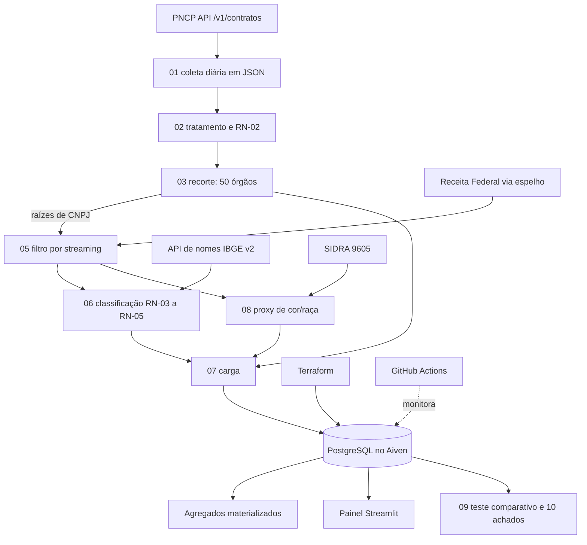

# Fornecedores societários: quem está por trás dos CNPJs que recebem dinheiro público

Trabalho de Big Data e Analytics, tema 9 (contratações públicas e fornecedores societários).
Grupo: Afonso de Menezes Alves Neto, Ana Júlia Gusmão do Nascimento, Iago César Lacerda Santos, Pedro Lucas Felix Aragão.

Painel: https://fornecedores-societarios.streamlit.app/

## Sumário
1. Problema e recorte
2. LGPD
3. Os 5 V's
4. Tipos de dado e fontes
5. Arquitetura e infraestrutura
6. Modelo de dados
7. Regras de negócio e testes
8. Redução de volume e desempenho
9. Resultados
10. Painel
11. Limitações
12. Fontes e como reproduzir

---

## 1. Problema e recorte

**Pergunta central:** quem são as pessoas por trás dos CNPJs que recebem dinheiro público, e há assimetria de gênero e de cor/raça nesse controle?

| Pergunta | Enunciado |
|---|---|
| Q1 | Há assimetria de gênero na captura de recurso público por fornecedores? |
| Q2 | Que leitura interseccional surge ao cruzar o gênero do controle com cor/raça (proxy territorial)? |
| Q3 | Quão concentrado é o valor entre fornecedores, e quanto os sócios se repetem entre eles? |

**Recorte.** Contratos publicados no PNCP entre 01/01/2025 e 31/12/2025 (endpoint `/v1/contratos`), assinados em 2025, limitados aos 50 órgãos com maior valor contratado após os filtros da RN-02. A raiz de 8 dígitos do CNPJ de cada fornecedor é cruzada com o quadro societário da Receita Federal.

**Funil (execução de 20/11/2026).**

| Etapa | Contratos | Removidos |
|---|---:|---:|
| Coletados (365 dias de publicação) | 2.022.965 | |
| Sem contratos de receita (`receita = false`) | 2.001.851 | 21.114 |
| `valor_global` > 0 | 1.984.718 | 17.133 |
| `valor_global` ≤ R$ 1 bi | 1.984.481 | 237 |
| Assinados de 01/01 a 31/12/2025 | 1.847.543 | 136.938 |
| **Top 50 órgãos por valor** | **190.806** | 1.656.737 |
| desses, fornecedor PJ com raiz de CNPJ | 184.275 | |
| desses, fornecedor pessoa física (PF) | 5.767 | |
| desses, fornecedor estrangeiro (PE) | 763 | |
| desses, PJ sem raiz válida | 1 | |
| **Base analítica do painel** (PJ com cadastro na Receita) | **184.274** | |

A base analítica tem 28.235 fornecedores distintos e R$ 353,3 bi em `valor_global`. O recorte tem 28.236 raízes de CNPJ: uma delas (`99999990`, 1 contrato) não existe na Receita (seção 11).

**Por que 50 órgãos.** Os 50 maiores órgãos concentram R$ 362,8 bi dos R$ 690,8 bi elegíveis (52,5% do valor) com 10,3% dos contratos. O recorte mantém mais da metade do dinheiro e cabe com folga no plano gratuito do banco (102,4 MB de 1 GB). O número de órgãos é um parâmetro do `03_recorte_cnpjs.py`: ampliá-lo exige refazer os passos 8 a 14 da seção 12.

| Maiores órgãos do recorte | Contratos | Valor |
|---|---:|---:|
| Consórcio Interfederativo Minas Gerais (CIMINAS) | 1.067 | R$ 148,9 bi |
| DNIT | 1.234 | R$ 21,2 bi |
| Consórcio Público Intermunicipal de Saúde do Setentrião Paranaense | 419 | R$ 19,9 bi |
| Ministério da Saúde | 14.932 | R$ 16,1 bi |
| Fundação Oswaldo Cruz | 7.706 | R$ 11,4 bi |

Um único órgão (CIMINAS) responde por 41% do valor do recorte. Por isso os resultados de valor são apresentados em cinco cenários (seção 9).

---

## 2. LGPD

Parecer completo em `docs/lgpd.md`. Resumo:

- **Base:** dados públicos (PNCP e Receita Federal), uso acadêmico, finalidade estatística.
- **Minimização:** o banco não recebe nome de sócio nem CPF. O nome só existe em memória durante o script de classificação. O sócio é identificado por um hash (SHA-256 de `ID_SALT` + máscara do CPF + nome completo normalizado, truncado em 16 caracteres). O sal fica no `.env`, nunca no Git.
- **Gênero** é inferido do primeiro nome (RN-04) e guardado só como categoria (F, M, I) com a confiança.
- **Cor/raça individual não existe no projeto.** Só há proxy territorial (percentual do município). Nenhuma análise atribui cor/raça a uma pessoa.
- **Empresário individual:** a razão social, que contém o nome da pessoa, é substituída por texto genérico no banco.
- **Mínimo de 5 fornecedores por recorte** no painel, para evitar reidentificação (RN-09). A classe de controle nunca aparece por empresa.
- **Cruzamento com o TSE foi rejeitado**, por permitir ligar nome a cor/raça autodeclarada de pessoas reais.
- Arquivos intermediários com nomes de sócios existem apenas em `data/` local, fora do Git, e devem ser apagados ao fim da disciplina.
- Testes automáticos conferem que os arquivos de saída não têm coluna de nome ou CPF nem valores com formato de CPF (seção 7.3).

---

## 3. Os 5 V's

| V | Evidência |
|---|---|
| **Volume** | Receita: 37 arquivos ZIP, 7,76 GB compactados (Estabelecimentos 5,38; Empresas 1,38; Sócios 0,69; Simples 0,31; domínios menos de 0,01). Os 30 arquivos usados somam 7,45 GB compactados e 25,50 GB descompactados, com 171.792.838 linhas lidas. PNCP: 2.022.965 registros brutos em 365 arquivos NDJSON (3,37 GB). |
| **Velocidade** | Filtro da Receita: 171,8 milhões de linhas em cerca de 4,3 minutos (257 s somando os arquivos), por streaming, sem gravar o bruto. Coleta do PNCP diária e retomável. Monitoramento semanal no GitHub Actions (seção 5.5). |
| **Variedade** | JSON (PNCP), ZIP com CSV (Receita), JSON de API (nomes do IBGE), séries tabulares (SIDRA), texto livre (objeto do contrato). |
| **Veracidade** | Contratos de receita, valores não positivos, valores acima de R$ 1 bi e assinaturas fora de 2025 são excluídos (RN-02). Gênero tem limiar de confiança. A cobertura de sócios é medida (86,7% das raízes). 80 testes automáticos conferem as regras. O próprio campo `valor_global` tem problemas, e um terço do valor total está em contratos de valor repetido (seção 9.4). |
| **Valor** | Entre as empresas de controle definido, as de controle feminino são 31,5% dos fornecedores e 30% dos contratos, mas o contrato mediano delas vale 0,67 do mediano das masculinas, em todos os cinco cenários de valor. O 1% maior de fornecedores fica com 35% a 62% do valor, conforme o cenário. Detalhes na seção 9. |

---

## 4. Tipos de dado e fontes

### 4.1 Tipos de dado

| Tipo | Fonte | Exemplos |
|---|---|---|
| Semiestruturado | PNCP, `/v1/contratos` (41 campos, 21 lidos) | `numero_controle_pncp`, `orgao_cnpj`, `valor_global`, `data_assinatura` |
| Estruturado (tabular, delimitado) | Receita Federal, CNPJ (Empresas, Estabelecimentos, Sócios, domínios) | `cnpj_basico`, `natureza_juridica`, `qualificacao_socio` |
| Estruturado (API) | IBGE nomes v2; SIDRA 9605 | frequência por nome; população por cor/raça e município |
| Não estruturado | Campo `objeto_contrato` do PNCP | descrição livre do que foi contratado (truncada em 500 caracteres no banco) |

Colunas usadas, descartadas e o dicionário de dados do banco estão em `docs/mapa_colunas.md`.

### 4.2 Receita Federal

A URL oficial (`dadosabertos.rfb.gov.br`) estava inacessível durante o trabalho. Foi usado o espelho da Casa dos Dados (`dados-abertos-rf-cnpj.casadosdados.com.br`), que republica os arquivos da Receita. Os arquivos lidos têm data de 18/09/2026 e foram acessados em 20/11/2026.

O inventário foi feito por streaming, sem baixar os ZIP inteiros (`docs/inventario_receita.xlsx`).

### 4.3 Fontes complementares

- **Gênero:** API de nomes do IBGE v2 (Censo 2010), documentada e estável. A v3 (Censo 2022) não consta da documentação pública. As respostas ficam em cache local (`data/interim/cache_nomes_ibge.json`), então cada nome é consultado uma só vez. Foram 7.136 primeiros nomes distintos.
- **Proxy territorial de cor/raça:** SIDRA, tabela 9605 (Censo 2022), variável 93 (população residente, em pessoas), classificação 86 (cor ou raça), nível município. Foram 27 chamadas (uma por UF), com 5.570 municípios e 203.080.756 pessoas, todos com valor. No país, pretos e pardos somam 55,5% e brancos 43,5%. Calculamos o percentual de cada categoria e `pct_negra` (preta + parda).
- **Tradução de município:** o código da Receita (4 dígitos) difere do código do IBGE (7 dígitos). A ligação usa nome normalizado e UF: 5.527 de 5.544 pares (99,7%) foram traduzidos, cobrindo 99,8% dos estabelecimentos. Em `dim_fornecedor`, 20 de 28.235 fornecedores ficaram sem código IBGE.

### 4.4 Piloto de gênero

1.000 sócios PF sorteados (semente 42) das primeiras 200 mil linhas de `Socios0`, com 538 nomes distintos.

| Resultado | % |
|---|---:|
| Feminino | 37,2 |
| Masculino | 57,2 |
| Ambíguo | 2,1 |
| Nome ausente | 3,5 |

Sensibilidade ao limiar de confiança (indeterminados): 80% → 4,6%; **90% → 5,6%**; 95% → 6,3%; 99% → 9,6%. O limiar de 90% foi mantido. O piloto da 1ª Unidade, que usou o Censo 2022 em outro arquivo, deu 3,7% a 90%. A diferença de 1,9 ponto não separa efeito da fonte de efeito da amostra, e fica declarada como limitação.

### 4.5 Classificação na base completa

48.365 sócios PF, 7.136 primeiros nomes distintos (limiar de 90%).

| Gênero | Sócios | % |
|---|---:|---:|
| Masculino | 30.542 | 63,1 |
| Feminino | 15.763 | 32,6 |
| Indeterminado: ambíguo | 484 | 1,0 |
| Indeterminado: nome ausente | 1.576 | 3,3 |

Qualificações mais frequentes dos sócios PF: Sócio-Administrador 27.205; Sócio 11.213; Diretor 3.751; Administrador 3.446; Presidente 1.400; Conselheiro de Administração 669.

**Controle das 28.235 empresas.**

| Classe | RN-03 padrão | | RN-03 estrita | |
|---|---:|---:|---:|---:|
| Masculino, por maioria | 12.351 | 43,7% | 11.113 | 39,4% |
| Feminino, por maioria | 5.684 | 20,1% | 5.397 | 19,1% |
| Misto: sem maioria | 3.267 | 11,6% | 3.101 | 11,0% |
| Misto: com sócio PJ | 2.037 | 7,2% | 2.037 | 7,2% |
| Misto: mais de 1/3 indeterminados | 1.140 | 4,0% | 1.073 | 3,8% |
| Sem sócio elegível | 3.756 | 13,3% | 5.514 | 19,5% |
| **Controle definido** | **18.035** | **63,9%** | **16.510** | **58,5%** |
| Entre as de controle definido, % femininas | 31,5% | | 32,7% | |

A regra estrita (seção 7.1) tira Diretor, Presidente, Conselheiro e a qualificação exatamente "Administrador". O Sócio-Administrador continua contando nas duas.

Empresas sem sócio elegível, por natureza jurídica (regra padrão): Empresário (Individual) 3.303 (87,9%); Autarquia Municipal 134; Município 110; Serviço Social Autônomo 30; Órgão Público do Poder Executivo Municipal 27.

---

## 5. Arquitetura e infraestrutura

### 5.1 Infraestrutura como código

O serviço `pg-fornecedores` é criado por Terraform (`terraform/`), no Aiven, plano `free-1-1gb`, projeto `ucsal-66ba`. O schema com 9 tabelas é aplicado por `etl/aplicar_schema.py`.

    cd terraform
    copy terraform.tfvars.example terraform.tfvars    # edite project_name
    terraform init
    terraform apply

O reprovisionamento foi comprovado em clone limpo (`docs/terraform_apply_maquina_limpa.txt` e `docs/img/aiven_running_maquina_limpa.png`). A primeira instância está em `docs/terraform_apply.txt`, `docs/terraform_state.txt` e `docs/img/aiven_running.png`.

### 5.2 Limites do plano gratuito

- 1 GB de disco (o plano free era de 5 GB até 15/05/2025).
- 20 conexões.
- O serviço é desligado por inatividade. É preciso religá-lo antes da carga e da apresentação.
- Um único PostgreSQL gratuito por organização: por isso um segundo `terraform apply` com o serviço no ar falha com 403.
- Orçamento do projeto: banco com no máximo 600 MB. Medido ao fim da carga: **102,4 MB**.

### 5.3 Segredos

`terraform.tfvars`, `.env`, `data/` e `*.tfstate` estão no `.gitignore`. O token do Aiven vai pela variável de ambiente `TF_VAR_aiven_api_token`, que o Terraform liga à variável `aiven_api_token` de `variables.tf`. O `.env` guarda `DATABASE_URL`, `ID_SALT` e `RECEITA_URL`. No Streamlit Cloud e no GitHub Actions, a `DATABASE_URL` fica em Secrets. O token que apareceu em tela durante o trabalho foi revogado e substituído.

### 5.4 Problemas encontrados e resolvidos

| Problema | Causa | Solução |
|---|---|---|
| 401 no Terraform | token copiado errado; depois, variável de ambiente ausente no terminal | recriar o token e definir a variável na sessão |
| 403 ao criar o serviço | a organização já tinha um PostgreSQL gratuito | destruir o serviço antigo |
| 404 no clone limpo | `project_name` com o texto de exemplo | editar `terraform.tfvars` |
| URL oficial da Receita fora do ar | indisponibilidade | espelho declarado |
| Códigos de município diferentes entre Receita e IBGE | tabelas de códigos distintas | tradução por nome normalizado e UF (99,7% dos pares) |
| Teste de raiz sem cadastro falhou | 1 CNPJ (`99999990`) do PNCP inexistente na Receita | teste tolera até 0,1% dos contratos; caso documentado |
| Aiven criado com schema antigo, sem `ponte.elegivel` | o `CREATE TABLE IF NOT EXISTS` ignora tabela existente | o `07` aplica `ALTER TABLE ... ADD COLUMN IF NOT EXISTS` |
| Dúvida sobre o município do contrato | `fato_contrato.codigo_ibge` podia ser o do fornecedor | `14_checar_uf_orgao.py` mostrou que é o da unidade contratante |

### 5.5 Monitoramento agendado

`.github/workflows/monitoramento.yml` roda toda segunda-feira (e a cada push na `main`): executa os testes, mede a resposta das APIs de origem e do banco (`etl/checar_saude.py`, com 3 tentativas por chamada) e arquiva o log como artefato. No runner não existe `data/`, então os 31 testes de dados são ignorados e rodam os 49 restantes. A verificação do banco só roda se o secret `DATABASE_URL` estiver cadastrado; sem ele, o log registra que foi pulada. É monitoramento, e não ingestão agendada: a coleta incremental precisaria de armazenamento entre execuções, que o runner não tem. O histórico das execuções está na aba Actions do repositório.

---

## 6. Modelo de dados

Modelo estrela com 9 tabelas, definido em `etl/sql/schema.sql` e descrito coluna a coluna em `docs/mapa_colunas.md`. Carga por `etl/07_carregar_aiven.py`: `COPY` em uma única transação, índices criados depois, `ANALYZE` e relatório de tamanho.

| Tabela | Papel | Linhas | Tamanho |
|---|---|---:|---:|
| `fato_contrato` | um contrato por linha, com valor, prazo e objeto | 190.806 | 70,1 MB |
| `ponte_empresa_socio` | relação N:N entre empresa e sócio, com `elegivel` | 51.393 | 8,5 MB |
| `dim_socio` | sócio por hash, tipo, gênero e confiança | 48.952 | 7,4 MB |
| `dim_fornecedor` | raiz de CNPJ, porte, natureza, UF, município e classificação do controle | 28.235 | 6,8 MB |
| `dim_municipio` | os 5.570 municípios, com população e `pct_negra` | 5.570 | 0,8 MB |
| `dim_cnae` | atividade econômica | 1.359 | 0,3 MB |
| `dim_tempo` | calendário diário (`yyyymmdd`) | 365 | 0,1 MB |
| `dim_orgao` | órgão contratante | 50 | < 0,1 MB |
| `dim_modalidade` | tipo de contrato e categoria do processo | 54 | < 0,1 MB |
| **Banco inteiro** | dados e índices | | **102,4 MB** |

Decisões do modelo:

- `dim_modalidade` combina tipo de contrato e categoria do processo, porque a modalidade real da licitação está na compra, que não foi coletada.
- A ponte é necessária porque um sócio pode estar em várias empresas e uma empresa tem vários sócios.
- `fato_contrato` mantém fornecedor PF, estrangeiro ou sem raiz válida com `cnpj_raiz_fornecedor` nulo, para não perder o contrato (6.532 contratos: 6.531 com raiz nula na origem e 1 com raiz sem cadastro na Receita).
- `fato_contrato.codigo_ibge` é o município da **unidade contratante**. O `14_checar_uf_orgao.py` mostrou que órgãos estaduais e municipais têm 100% dos contratos numa UF e que só 63,6% dos contratos coincidem com a UF do fornecedor. Para órgãos federais, é a unidade que assinou, e não Brasília (por exemplo, só 71,7% dos contratos do Ministério da Saúde estão no RJ).
- `dim_municipio` recebe todos os municípios do Censo 2022, e não só os que aparecem nos contratos, para que o proxy racial esteja disponível a qualquer cruzamento.
- `dim_fornecedor.codigo_ibge` vem da tradução município da Receita → IBGE (seção 4.3). Os 20 fornecedores sem tradução ficam fora do recorte racial.
- `dim_cnae.pct_negra_setor`, `dim_cnae.pct_mulher_setor` (proxy setorial por RAIS ou CAGED) e `fato_contrato.sancionado_na_assinatura` (RN-08) existem no schema e **não são preenchidos**: ficaram fora do escopo (seção 11).
- Os `CHECK` do schema (`tipo`, `genero`, `classificacao_controle`) são verificados antes da carga pelos testes da seção 7.3. A carga de 190.806 contratos passou sem violar nenhuma chave nem restrição.

**Verificações da carga (`07 --simular`):** 0 vínculos fora de `dim_fornecedor`; 0 chaves repetidas em ponte, fato e fornecedor; 0 contratos com município fora de `dim_municipio`; 1 contrato com raiz sem cadastro na Receita.

---

## 7. Regras de negócio e testes

### 7.1 Regras

| Regra | Descrição | Estado |
|---|---|---|
| RN-01 | O fornecedor é identificado pela raiz do CNPJ (8 dígitos). | implementada e testada |
| RN-02 | Exclui contratos de receita; mantém `valor_global` > 0 e ≤ R$ 1 bi; exige assinatura em 2025. | implementada e testada |
| RN-03 | Define o sócio elegível (detalhe abaixo). | implementada e testada |
| RN-04 | Gênero pelo primeiro nome, API v2 do IBGE, limiar de 90% (abaixo disso, indeterminado). | implementada e testada |
| RN-05 | Classifica o controle da empresa (detalhe abaixo). | implementada e testada |
| RN-06 | Proxy territorial de cor/raça (percentuais do município, Censo 2022). | implementada: `08`, `dim_municipio`, aba Interseccional do painel |
| RN-07 | Concentração: Gini, HHI, parcela dos maiores fornecedores e sócios em 2+ fornecedores. | implementada: `10_achados.py`, painel, agregados |
| RN-08 | Marca contratos com empresa sancionada (CEIS e CNEP) na assinatura. | **não implementada** (fora do escopo) |
| RN-09 | Minimização de dados e mínimo de 5 fornecedores por recorte. | implementada e testada (minimização); implementada no painel (mínimo de 5) |

**RN-02 (execução completa).**

- **Receita:** 21.114 contratos (1,0%) têm `receita = True` (no PNCP, `True` é receita e `False` é despesa) e saem. Eles somam R$ 32,1 bi.
- **Valor:** 17.133 contratos com `valor_global` ≤ 0 saem. 237 acima de R$ 1 bi saem; considerando os 241 do tratamento inicial, eles somavam R$ 17,47 tri, 95,8% do valor positivo bruto, e incluem erros evidentes de digitação (por exemplo, um contrato de R$ 6 tri da Secretaria Municipal de Cultura de São Paulo).
- **Ano de assinatura:** 136.938 contratos saem por terem sido assinados fora de 2025. A maioria foi assinada em 2024, mas há datas absurdas (ano 8406 e 2030).
- **Anulados e cancelados** não podem ser excluídos, porque o endpoint não traz a situação do contrato.

**RN-03: quem conta como sócio.**

- Só pessoa física (PF) é elegível. Sócios PJ e estrangeiros (ES) nunca são.
- Não contam as qualificações de representação: procurador, representante, inventariante, liquidante, interventor, tutor, curador, mãe e pai.
- Regra padrão: administradores, diretores, presidentes e conselheiros contam.
- Regra estrita (`--excluir-administradores`, usada como sensibilidade): saem também Diretor, Presidente, Conselheiro e a qualificação exatamente "Administrador". O Sócio-Administrador continua contando.
- Vínculos repetidos (mesmo sócio, empresa e qualificação) são removidos (0 na base atual).
- **Decisão:** a regra padrão segue o roteiro da disciplina e é a principal; a estrita é sensibilidade (controle definido em 63,9% contra 58,5% das empresas, e 31,5% contra 32,7% de femininas).

**RN-05: classificação do controle da empresa**, nesta ordem de decisão (a primeira condição verdadeira vence):

| Ordem | Condição | Classe |
|---|---|---|
| 1 | a empresa tem algum sócio PJ no quadro (elegível ou não) | misto/indeterminado, motivo "sócio PJ" |
| 2 | nenhum sócio elegível | sem sócio elegível |
| 3 | mais de 1/3 dos elegíveis com gênero indeterminado | misto/indeterminado |
| 4 | mais da metade dos elegíveis são mulheres | feminino |
| 5 | mais da metade dos elegíveis são homens | masculino |
| 6 | nenhum dos anteriores (por exemplo, empate) | misto/indeterminado, "sem maioria" |

A ordem importa: uma empresa só com sócio PJ é "misto com sócio PJ", e não "sem sócio elegível". O `pct_indeterminados` da empresa é a parte de indeterminados entre os elegíveis.

### 7.2 Concentração de valor no recorte

| Contratos acima de | Quantidade | Parte do valor |
|---|---:|---:|
| R$ 10 mi | 3.593 | 90,9% |
| R$ 50 mi | 1.580 | 78,9% |
| R$ 100 mi | 797 | 63,9% |
| R$ 500 mi | 141 | 24,8% |

Menos de 0,5% dos contratos carrega quase dois terços do valor. Por isso os resultados de valor são sempre acompanhados de contagem e mediana, e apresentados em cinco cenários (seção 9). O painel tem filtros para excluir contratos acima de R$ 100 mi, o CIMINAS e os valores possivelmente replicados.

### 7.3 Testes automáticos

    pip install pytest
    python -m pytest tests -v

| Arquivo | O que verifica | Testes |
|---|---|---:|
| `tests/test_regras.py` | dados reais: RN-01 a RN-05 recalculadas a partir dos vínculos, compatibilidade com os `CHECK` do schema, unicidade das chaves da ponte, ausência de nome e CPF (RN-09) | 31 |
| `tests/test_unitarios.py` | `genero.py` e `06` com dados sintéticos: limiar de 90% (inclusivo), cache, qualificações da RN-03, ordem de decisão da RN-05 e inversão do controle na regra estrita | 39 |
| `tests/test_painel_dados.py` | camada de dados do painel: colunas, classes, RN-02, faixas, reprodutibilidade e marcação de valor replicado | 10 |

**80 testes passando** em 20/11/2026, com a base completa. Saída em `docs/testes_regras.txt`. Os testes de dados são rodados de novo no congelamento do código (23/11/2026).

---

## 8. Redução de volume e desempenho

### 8.1 Redução de volume

| Etapa | Antes | Depois |
|---|---|---|
| Receita, compactado | 7,76 GB (37 arquivos) | 7,45 GB lidos (30 arquivos usados) |
| Receita, descompactado | 25,50 GB | 4,1 MB em Parquet |
| Receita, linhas | 171.792.838 lidas | 227.138 mantidas (0,1322%) |
| **Fator de redução da Receita** | | **6.181×** sobre o descompactado; 1.806× sobre o compactado |
| PNCP, JSON bruto | 3,37 GB (2.022.965 registros) | 372,8 MB em Parquet tratado (cerca de 9× menor) |
| PNCP, recorte | | 190.806 contratos, 29,7 MB em Parquet |
| Proxy racial (SIDRA) | 27 chamadas de API | 5.570 municípios em um Parquet de 0,2 MB |
| Banco no Aiven | | 102,4 MB |

Linhas mantidas da Receita: Sócios 51.393 (1,6 MB), Empresas 28.235 (0,9 MB), Estabelecimentos 147.510 (1,6 MB). Cobertura sobre as 28.236 raízes do recorte: Empresas e Estabelecimentos 100% (28.235), Sócios 86,7% (24.480 raízes). A redução da Receita vem do filtro por streaming (`stream_unzip`): o arquivo bruto nunca é gravado em disco.

### 8.2 Teste comparativo: Pandas × PostgreSQL

Três consultas rodadas de quatro formas, mediana de 5 repetições, na mesma máquina (`etl/09_teste_comparativo.py`; saída em `docs/teste_comparativo.md`). O script confere se as quatro formas devolvem o mesmo resultado antes de comparar tempos: **os resultados bateram nas três consultas**.

| Consulta | Pandas (lê Parquet e calcula) | Pandas (em memória) | PostgreSQL (junções) | PostgreSQL (agregado materializado) |
|---|---:|---:|---:|---:|
| A. valor por classe de controle (junção de 2 tabelas) | 340,9 ms | 181,9 ms | 473,1 ms | 163,8 ms |
| B. sócios em 2+ fornecedores (junção N:N pela ponte) | 710,2 ms | 406,9 ms | 370,2 ms | 164,1 ms |
| C. 10 maiores fornecedores (agregação) | 312,8 ms | 164,1 ms | 811,9 ms | 261,5 ms |

Latência de rede até o Aiven (`SELECT 1`): 164,5 ms. Leitura dos 3 Parquet: 0,32 s. Criação dos 5 agregados materializados: 5,7 s (2,21 MB).

**Leitura honesta.**

- Com 190 mil contratos, o Pandas em memória é mais rápido que as junções no PostgreSQL nas consultas A e C (2,6× e 4,9×), porque não paga rede. Na consulta B, os dois ficam praticamente empatados (407 ms contra 370 ms).
- O tempo do agregado materializado (164 a 262 ms) é quase só a latência da rede: a consulta em si custa perto de zero. Comparado com o que um painel sem arquivos locais precisaria fazer (ler os Parquet e calcular), o agregado é 2,1× (A), 4,3× (B) e 1,2× (C) mais rápido.
- O teste foi feito em uma única máquina e rede, com 5 repetições. Ele indica ordem de grandeza e não um benchmark.
- O painel atual lê o fato por junções e agrega em Pandas, com cache de 1 hora. Os agregados materializados foram criados e medidos aqui, mas o painel ainda não os consome.

### 8.3 Relacional × não relacional

Usamos os dois, cada um onde faz sentido:

- **Camada bruta em arquivos:** o JSON do PNCP (41 campos, esquema que pode mudar) fica em NDJSON e a Receita é lida por streaming. Aqui o esquema flexível e o custo baixo de armazenamento pesam mais do que a consulta.
- **Camada analítica em PostgreSQL:** o modelo é um conjunto de entidades ligadas por chaves, com uma relação N:N (empresa e sócio: 51.393 vínculos, 1.596 sócios em 2 ou mais fornecedores). As perguntas Q1 a Q3 são junções e agregações. Em um banco de documentos, a relação N:N exigiria duplicar dados ou fazer buscas aninhadas, e a integridade ficaria por conta do código.
- **O que o banco entregou:** as chaves e os `CHECK` aceitaram 190.806 contratos sem erro; a ponte impede vínculo duplicado; os agregados dão consultas de resumo praticamente limitadas pela rede; vários acessos ao painel não exigem que cada um carregue os arquivos.
- **O que o banco não entregou:** velocidade bruta nesta escala. O argumento a favor do banco é integridade, compartilhamento e escala futura, não tempo de consulta.

---

## 9. Resultados

Base: 184.274 contratos, 28.235 fornecedores, R$ 353,3 bi (`etl/10_achados.py`, com conferência independente por SQL: contagem, valor total e % do valor feminino conferem com o painel). Os indicadores de gênero usam só empresas de **controle definido** (feminino ou masculino), que concentram 63,3% do valor.

Valor por classe de controle: feminino 12,6%; masculino 50,7%; misto/indeterminado 29,1%; sem sócio elegível 7,6%.

### 9.1 Q1: gênero do controle

| Cenário | Contratos | Valor | % do valor feminino | % dos contratos | % dos fornecedores | Razão das medianas (F ÷ M) |
|---|---:|---:|---:|---:|---:|---:|
| Todos os contratos | 184.274 | R$ 353,3 bi | 19,9 | 29,9 | 31,5 | 0,67 |
| Sem contratos acima de R$ 100 mi | 183.496 | R$ 128,0 bi | 26,9 | 30,0 | 31,7 | 0,68 |
| Sem o CIMINAS | 183.207 | R$ 204,5 bi | 24,2 | 30,0 | 31,7 | 0,68 |
| Sem os dois | 182.872 | R$ 111,0 bi | 27,9 | 30,0 | 31,8 | 0,68 |
| Sem valores possivelmente replicados | 183.299 | R$ 235,2 bi | 17,4 | 29,9 | 31,3 | 0,67 |

**Leitura.** Contagens e medianas quase não mudam entre os cinco cenários: empresas de controle feminino são cerca de 30% dos contratos e o contrato mediano delas vale cerca de dois terços do das masculinas. A parcela do valor oscila (17,4% a 27,9%) porque poucos contratos gigantes e valores repetidos dominam o total. O achado mais firme é o tamanho do contrato, e não o acesso: os 31,5% descrevem só os fornecedores do recorte e não têm baseline externo, então não dá para dizer que há menos mulheres do que o esperado sem comparar com a base inteira da Receita, que não foi carregada.

### 9.2 Q2: composição racial do município do fornecedor (proxy territorial)

Fornecedores de controle definido, por faixa de pretos e pardos no município do fornecedor (Censo 2022). 184.239 contratos têm município traduzido. Fornecedores e razão das medianas são da base inteira.

| Faixa de pretos e pardos | Fornecedores | Razão das medianas (F ÷ M) | % do valor feminino: todos | sem > R$ 100 mi | sem replicados |
|---|---:|---:|---:|---:|---:|
| até 30% | 2.816 | 0,34 | 25,7 | 31,2 | 17,4 |
| 30% a 50% | 5.381 | 0,63 | 18,2 | 32,0 | 15,5 |
| 50% a 70% | 6.920 | 0,60 | 21,5 | 23,2 | 20,0 |
| 70% ou mais | 2.909 | 1,19 | 13,1 | 17,1 | 13,1 |

**Leitura.** A razão das medianas varia no máximo 0,02 entre os três cenários, mas **não forma um gradiente**: a maior distância está na faixa até 30% (mediana feminina a um terço da masculina) e há inversão em 70% ou mais. A parcela do valor feminino oscila muito (na faixa de 30% a 50% vai de 15,5% a 32,0% conforme o cenário). As faixas funcionam como regiões do país misturadas com tipo de contrato e órgão. O resultado é um padrão territorial descritivo, sem leitura causal e sem nenhuma afirmação sobre a cor ou raça dos sócios.

### 9.3 Q3: concentração

| Cenário | Fornecedores | 10 maiores | 1% maiores | Gini | HHI |
|---|---:|---:|---:|---:|---:|
| Todos os contratos | 28.235 | 6,4% | 55,2% (282) | 0,956 | 17 |
| Sem contratos acima de R$ 100 mi | 27.929 | 5,2% | 34,7% (279) | 0,923 | 11 |
| Sem o CIMINAS | 27.660 | 9,8% | 56,3% (277) | 0,952 | 23 |
| Sem os dois | 27.541 | 6,0% | 37,9% (275) | 0,926 | 13 |
| Sem valores possivelmente replicados | 27.652 | 9,1% | 62,3% (277) | 0,959 | 24 |

**Leitura.** A desigualdade do valor entre fornecedores é muito alta (Gini acima de 0,92 em todos os cenários), mas nenhum fornecedor domina (os 10 maiores ficam com 5% a 10%). O 1% maior fica entre 34,7% e 62,3% do valor, conforme o cenário. Sem os valores replicados a concentração **sobe**: o teto repetido em cada contrato inflava o total de centenas de fornecedores médios (por exemplo, os 198 do consórcio do Paraná). Essa explicação é provável e não foi testada. O HHI é calculado sobre fornecedores de mercados diferentes: ele indica que ninguém domina, e não que o mercado seja competitivo.

**Concentração societária.** Dos 46.219 sócios elegíveis, 1.596 (3,5%) aparecem em 2 ou mais fornecedores do recorte, com máximo de 10. O número é um piso, porque conta só os fornecedores dos 50 órgãos, e pode estar um pouco inflado por homônimos (o identificador usa a máscara do CPF e o nome, seção 11).

### 9.4 Cuidados com `valor_global`

O diagnóstico `etl/12_verificar_grupos.py` encontrou 53 grupos de contratos do mesmo órgão com o mesmo valor (≥ R$ 10 mi) em 3 ou mais fornecedores. Em 49 deles (933 contratos, R$ 112,6 bi, 31,9% do valor) o objeto é idêntico, o que indica o teto de um credenciamento ou ata repetido em cada contrato. O maior é do CIMINAS (46 contratos, 26 fornecedores, R$ 581,5 mi cada), e o consórcio de saúde do Paraná tem 202 contratos de R$ 71,4 mi em 198 fornecedores. Em 2 grupos (27 contratos, R$ 5,3 bi) os objetos diferem e podem ser legítimos (Comando do Exército e FCDF), e em 2 (15 contratos, R$ 0,2 bi) são quase iguais.

A marcação do painel cobre os 53 grupos: 975 contratos, R$ 118,1 bi, 33,4% do valor. Ela é conservadora, porque inclui os 42 contratos de objetos diferentes ou quase iguais. É um indício, não uma confirmação. Nenhum contrato foi excluído da base; o painel e o `10_achados.py` oferecem o cenário sem eles. Por isso a contagem e a mediana são as medidas principais, e os valores totais devem ser lidos como limite superior.

### 9.5 Conferência manual

Dois KPIs foram refeitos em planilha, fora do código, a partir de dados exportados por `etl/13_exportar_conferencia.py`: o percentual do valor com controle feminino (19,867%) e os sócios em 2 ou mais fornecedores (1.596 de 46.219). Os valores coincidem com os do banco e do painel (`docs/conferencia_manual.md`).

---

## 10. Painel

Streamlit (`app/app.py`, camada de dados em `app/dados.py`), com Plotly. Publicado em https://fornecedores-societarios.streamlit.app/, em modo banco (PostgreSQL do Aiven) desde 20/11/2026.

- **Duas fontes com o mesmo formato:** `PAINEL_FONTE = ficticio` (padrão, com aviso fixo no topo) ou `banco` (com `DATABASE_URL`, em Secrets no Streamlit Cloud). Em modo fictício, nenhum número descreve algo real.
- **KPIs do topo:** contratos, fornecedores, valor contratado e valor mediano.
- **Abas:** Gênero do controle (Q1), Interseccional (Q2), Concentração (Q3) e Drill-down.
- **Filtro cruzado:** clicar nas barras de gênero ou de UF filtra todo o painel, com botão para limpar a seleção.
- **Seletor de métrica:** valor contratado, número de contratos ou valor mediano.
- **Filtros laterais:** UF do órgão (a UF da unidade contratante), UF do fornecedor, órgão, porte, faixa de valor e meses.
- **Cenários de valor:** caixas para excluir contratos acima de R$ 100 mi, o CIMINAS e os valores possivelmente replicados. Com algum cenário ativo, um aviso no topo lembra que os números não são os da base inteira.
- **Drill-down:** UF, depois órgão, depois os 50 maiores contratos, com a marca de valor possivelmente replicado.
- **RN-09:** grupos com menos de 5 fornecedores ficam ocultos; a classe de controle nunca aparece por empresa; a aba Interseccional avisa que o percentual racial é do município.
- **Desempenho:** a consulta traz 184 mil contratos e é guardada em cache por 1 hora. Os agregados materializados ainda não são usados pelo painel.
- **Disponibilidade:** o plano gratuito do Aiven desliga por inatividade. Se o banco estiver desligado, o painel explica o erro em vez de quebrar.

---

## 11. Limitações

- **`valor_global` não é o valor pago** e pode repetir o teto de credenciamento ou da ata em vários contratos: 33,4% do valor está em grupos de valor repetido (seção 9.4). Totais de valor são limite superior.
- **Valores concentrados:** 797 contratos acima de R$ 100 mi (0,4%) carregam 63,9% do valor, e o CIMINAS sozinho responde por 41%. Por isso há cinco cenários e a mediana como medida principal.
- **Borda direita:** a coleta é por data de publicação, então contratos assinados no fim de 2025 e publicados depois podem faltar. Por outro lado, 136.938 contratos publicados em 2025 foram assinados em outros anos e foram excluídos.
- **Sem situação do contrato:** anulados e cancelados não são identificáveis.
- **Campos incompletos:** 29,7% dos contratos não têm `valor_parcela` e 76,3% não têm `valor_acumulado`.
- **Valores com erro de digitação:** o teto de R$ 1 bi elimina os mais absurdos, mas não garante que todo valor abaixo dele esteja correto.
- **UF do órgão é a da unidade contratante:** para órgãos federais, que assinam em várias unidades, não é Brasília (seção 6).
- **Fornecedor PF, estrangeiro ou sem raiz válida:** 6.532 contratos (3,4% do recorte) não entram na análise societária: 6.531 não têm CNPJ e 1 (R$ 243.162,50, Estado de Goiás, 29/05/2025) tem a raiz `99999990`, provável erro de digitação ou CNPJ de teste no PNCP.
- **Cobertura de sócios:** 13,3% das empresas (3.756) não têm sócio elegível, e 87,9% delas são empresários individuais, que não têm quadro societário na Receita.
- **Gênero:** inferido do primeiro nome e sujeito a erro. Nome ambíguo ou ausente vira indeterminado (4,3% dos sócios PF). A base do IBGE é o Censo 2010. A diferença de 1,9 ponto contra o piloto da 1ª Unidade não foi explicada.
- **Sem baseline externo para Q1:** os 31,5% de fornecedores de controle feminino descrevem só o recorte. Comparar com a população de empresas exigiria carregar a base inteira da Receita.
- **Administradores:** Diretor, Administrador, Presidente e Conselheiro somam 9.266 vínculos (19,2% dos sócios PF) e entram como controle na regra padrão. A regra estrita está como sensibilidade (58,5% de controle definido, contra 63,9%).
- **Sócio PJ:** qualquer sócio PJ no quadro torna o controle "misto", mesmo que os sócios PF sejam maioria (7,2% das empresas).
- **Identificador de sócio:** usa a máscara do CPF (6 dígitos centrais) e o nome completo, então homônimos podem colidir e inflar "sócios em 2+ fornecedores" (1.596).
- **Cor/raça é proxy ecológico.** O percentual descreve o município do estabelecimento do fornecedor, não o sócio, e as faixas se confundem com regiões do país. Qualquer leitura individual ou causal seria falácia ecológica.
- **Tradução de município:** 17 pares (0,2% dos estabelecimentos; 20 fornecedores) não foram traduzidos para o código IBGE, por diferença de grafia, e ficam fora da análise racial.
- **Escopo não cumprido:** RN-08 (CEIS e CNEP), proxy setorial (RAIS ou CAGED) e as colunas correspondentes do schema.
- **Fonte espelho:** a Receita foi lida de um espelho, não do portal oficial.
- **Plano gratuito:** 1 GB e desligamento por inatividade limitam o recorte e a disponibilidade.
- **Teste comparativo:** uma máquina, uma rede, 5 repetições (seção 8.2).

---

## 12. Fontes e como reproduzir

### Fontes

| Fonte | Endereço | Acesso |
|---|---|---|
| PNCP, contratos | API `/v1/contratos` | coleta entre agosto e 20/11/2026 |
| Receita Federal, CNPJ | espelho da Casa dos Dados (arquivos de 18/09/2026) | 20/11/2026 |
| IBGE, API de nomes v2 | `servicodados.ibge.gov.br/api/v2/censos/nomes` | 20/11/2026 |
| IBGE, SIDRA tabela 9605 | `servicodados.ibge.gov.br/api/v3/agregados/9605` | 20/11/2026 |

### Estrutura do repositório

    terraform/   infraestrutura (main, variables, outputs, tfvars de exemplo)
    etl/         scripts numerados e módulos (config, receita_stream, genero)
    etl/sql/     schema, índices, orçamento e agregados materializados
    app/         painel Streamlit (app.py e dados.py)
    tests/       testes de dados, unitários e do painel (pytest)
    docs/        lgpd, mapa de colunas e dicionário, inventário, testes, teste comparativo, conferência manual, notas do pitch
    .github/     workflow de monitoramento
    data/        raw, interim e processed (fora do Git)

### Passos

1. `terraform apply` (seção 5.1).
2. `python etl/aplicar_schema.py`
3. `python etl/00_inventario_receita.py` e `python etl/00b_planilha_inventario.py`
4. `python etl/01_coletar_pncp.py` (diário, retomável)
5. `python etl/02_tratar_contratos.py`
6. `python etl/03_recorte_cnpjs.py`
7. `python etl/02b_diagnostico.py`
8. `python etl/05_filtrar_receita.py --refazer` e depois `--consolidar`
9. `python etl/06_classificar_empresas.py` (e, para a sensibilidade, `--excluir-administradores`)
10. `python etl/08_proxy_racial.py` (depois do passo 8)
11. `python -m pytest tests -v`
12. `python etl/checar_aiven.py` (serviço ligado e banco pronto)
13. `python etl/07_carregar_aiven.py --simular`, depois `python etl/07_carregar_aiven.py` (ou `--recarregar`)
14. `python etl/09_teste_comparativo.py` (cria os agregados e mede os tempos)
15. `python etl/10_achados.py` e `python etl/11_diagnostico_repetidos.py`
16. `python etl/12_verificar_grupos.py` e `python etl/14_checar_uf_orgao.py`
17. `python etl/13_exportar_conferencia.py` (dados para a conferência manual em planilha, `docs/conferencia_manual.md`)
18. `streamlit run app/app.py` (modo fictício) ou, com `PAINEL_FONTE=banco`, contra o Aiven

Scripts auxiliares: `04_piloto_genero.py` (piloto da seção 4.4), `t3_checar_fontes.py` (checagem das fontes) e `checar_saude.py` (monitoramento).