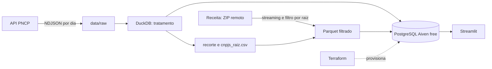

# Contratações Públicas e Fornecedores Societários

Big Data e Analytics, projeto prático, tema 9.
Grupo: Afonso de Menezes Alves Neto, Ana Júlia Gusmão do Nascimento, Iago César Lacerda Santos, Pedro Lucas Felix Aragão.

Pergunta central: **quem são as pessoas por trás dos CNPJs que recebem dinheiro público, e há assimetria de gênero e de cor/raça nesse controle?**

> **Estado em 20/11/2026 (remover na entrega).** Concluído: Terraform e banco no Aiven, schema, inventário da Receita, tratamento dos contratos, funil do recorte, mapa de colunas, parecer de LGPD e confirmação das fontes do IBGE. Em andamento: coleta do PNCP de 2025. Todo número marcado como *parcial* vem de uma coleta de 01/01 a 30/04/2025 (120 dias) e será refeito com o ano fechado. Itens `[PREENCHER]` dependem de medição; `[CONFIRMAR]` depende de decisão do grupo.

## 1. Problema, perguntas analíticas e recorte

- **Q1** Assimetria de gênero: participação de empresas de controle feminino no valor contratado e no número de contratos.
- **Q3** Concentração societária: quantos sócios (pessoas, não CNPJs) concentram o valor contratado; sócios em comum; vínculo com sancionados (CEIS/CNEP).
- **Q2** Camada interseccional: gênero do controle cruzado com composição de cor/raça por proxy setorial e territorial.

**Coleta:** contratos publicados no PNCP de 01/01/2025 a 31/12/2025, pela API de consulta (por data de publicação), um arquivo por dia.

**Recorte analítico (RN-02):** contratos de despesa, com valor global maior que zero e até R$ 1 bilhão, **assinados em 2025**, dos 50 órgãos de maior valor contratado.

**Justificativa do recorte por órgão:** (1) a Receita filtrada e o `fato_contrato` precisam caber no PostgreSQL gratuito (1 GB); (2) nos dados parciais, os 50 órgãos concentram 58,2% do valor elegível com 7,3% dos contratos. O valor de N é o ponto de partida e pode subir se o tamanho medido no banco (`etl/sql/budget.sql`) permitir. `[PREENCHER: N final e tamanho medido]`

**Viés de seleção declarado:** órgãos grandes (federais, estados, consórcios de saúde) pesam mais que municípios pequenos, então comparações entre UFs não representam o país.

**Funil do recorte (parcial, publicados de 01/01 a 30/04/2025):**

| Etapa | Contratos |
|---|---|
| Registros brutos | 580.776 |
| Após deduplicação por `numeroControlePNCP` | 572.866 |
| Sem contratos de receita | 567.691 |
| Valor global maior que zero | 563.632 |
| Valor global até R$ 1 bilhão | 563.547 |
| Assinados em 2025 | 460.951 |
| Top 50 órgãos por valor | 33.672 |
| Fornecedor PJ com CNPJ de 14 dígitos | 30.903 |
| Fornecedor PF | 2.574 |
| Fornecedor estrangeiro (PE) | 195 |
| Raízes de CNPJ distintas (lista para o filtro da Receita) | 10.366 |

Valor elegível: R$ 160,1 bilhões. Valor dos 50 órgãos: R$ 93,2 bilhões (58,2%).

## 2. LGPD e dados abertos

Texto completo em [`docs/lgpd.md`](docs/lgpd.md). Resumo:
- Contratos e quadro societário são dados públicos (Lei 12.527/2011 e Decreto 8.777/2016).
- Nome de sócio é dado pessoal mesmo sendo público: o CPF nunca é armazenado e o nome não é carregado no banco; o painel só publica agregados com no mínimo 5 sócios ou empresas por recorte (RN-09).
- Cor/raça é dado sensível (LGPD, art. 5º, II): não é inferida por pessoa, só por proxy ecológico (setor e município) atribuído ao contexto da empresa (RN-06).
- **Caminho rejeitado:** cruzar nome de sócio com bases de cor/raça autodeclarada (por exemplo candidaturas do TSE) seria reidentificação de dado sensível.
- Minimização na ingestão: e-mail, telefones, endereço, CEP, dados do representante legal e o campo `usuarioNome` do PNCP (quem enviou o contrato, que pode ser pessoa física) não são carregados.

## 3. Os 5 V's (números reais)

| V | Número medido | Decisão do pipeline |
|---|---|---|
| Volume | Receita: 7,76 GB compactado em 37 ZIP (Estabelecimentos 5,38; Empresas 1,38; Sócios 0,69; Simples 0,31; domínio menos de 0,01). PNCP: 580.776 registros nos primeiros 120 dias; JSON bruto de 1,08 GB em 137 dias (média de 7,9 MB por dia); Parquet de contratos de 101,8 MB (120 dias). Estimativa linear para o ano: cerca de 1,8 milhão de contratos, 2,9 GB de JSON bruto e 310 MB de Parquet | Receita lida em streaming (nada vai para o disco); Parquet na camada analítica; o Postgres recebe só o recorte |
| Velocidade | PNCP publica contratos todos os dias, com atraso: 98,3% dos contratos assinados fora de 2025 são de 2024, publicados em 2025; Receita atualiza mensalmente. `[PREENCHER: workflow do GitHub Actions]` | coleta incremental, retomável, um arquivo por dia; ingestão em lote agendada |
| Variedade | CSV (Receita), JSON aninhado (PNCP) e texto livre (`objetoContrato`) | DuckDB para o JSON, Parquet para a camada analítica |
| Veracidade | 1,4% de duplicatas no PNCP; 0,74% de valores menores ou iguais a zero; 87 contratos acima de R$ 1 bi concentrando 96,6% do valor somado (até R$ 1,1 trilhão: erro de digitação); 133 datas de assinatura impossíveis (ano 2026 ou 8406, posteriores à publicação); `valor_parcela` nulo ou zero em 32,1% dos contratos e `valor_acumulado` em 77,3%; 18 duplicatas em 200 mil linhas de sócios; piloto de gênero com 5,6% de nomes indeterminados em 1.000 sócios pessoa física (limiar de 90%); 166.980 máscaras de CPF contra 192.299 pares máscara+nome (usar só a máscara fundiria cerca de 13,2% das identidades) | deduplicação por chave natural; filtros da RN-02; só `valor_global` como métrica; identificador do sócio = máscara + nome |
| Valor | `[PREENCHER: achados da Fase 2]` | KPIs do painel |

As amostras de sócios e estabelecimentos da Receita são sequenciais (primeiras 200 mil linhas de um arquivo), não aleatórias.

## 4. Tipos de dado, colunas e fontes complementares

### 4.1 Os três tipos, com exemplo real

**Estruturado.** CSV da Receita (`;`, sem cabeçalho, latin-1). Sócios, com nome reduzido à inicial e máscara do CPF ocultada:

```
cnpj_basico  identificador_socio  nome_socio  cnpj_cpf_socio  qualificacao_socio  data_entrada_sociedade  faixa_etaria
12340763     2                    Z***        ***######**     22                  20100805                6
12340798     2                    D***        ***######**     22                  20170809                9
```

**Semi-estruturado.** JSON do PNCP, com objetos aninhados. Um contrato real, com 14 dos 41 campos:

```json
{
  "numeroControlePNCP": "04564530000113-2-000059/2024",
  "orgaoEntidade": {"cnpj": "04564530000113", "razaoSocial": "RONDONIA SECRETARIA DE ESTADO DA EDUCACAO", "poderId": "E", "esferaId": "E"},
  "unidadeOrgao": {"ufSigla": "RO", "municipioNome": "Porto Velho", "codigoIbge": "1100205"},
  "tipoContrato": {"id": 8, "nome": "Outros"},
  "categoriaProcesso": {"id": 2, "nome": "Compras"},
  "tipoPessoa": "PJ",
  "niFornecedor": "15086536000149",
  "nomeRazaoSocialFornecedor": "Chez Editora LTDA",
  "receita": false,
  "valorGlobal": 2058500.0,
  "valorParcela": 0.0,
  "dataAssinatura": "2024-12-31",
  "dataPublicacaoPncp": "2025-01-02T03:45:00",
  "objetoContrato": "SOLUÇÃO EDUCACIONAIS TECNOLÓGICAS - LEI 14.133/2021"
}
```

Este contrato foi assinado em 2024 e publicado em 2025: fica fora do recorte pela RN-02. Também mostra `valorParcela` igual a zero com uma parcela. Medido nos dados parciais, `valor_parcela` é nulo ou zero em 32,1% dos contratos e `valor_acumulado` em 77,3%; o painel usa só `valor_global`.

**Não estruturado.** O campo `objetoContrato`: texto livre em português, sem vocabulário controlado, em caixa alta, com referência legal embutida (exemplo acima).

### 4.2 Colunas usadas e descartadas

Mapa completo em [`docs/mapa_colunas.md`](docs/mapa_colunas.md). Em resumo: dos 41 campos do contrato do PNCP, 21 são lidos; da Receita ficam as colunas das regras RN-01 a RN-09, e saem endereço, telefone, e-mail, dados do representante legal e país do sócio.

### 4.3 Fontes complementares

| Uso | Fonte | Estado |
|---|---|---|
| Gênero (RN-04) | API de nomes do IBGE, `api/v2/censos/nomes/{nome}?sexo=F` e `sexo=M` (Censo 2010, documentada) | Testada em 20/11/2026 (status 200): devolve a frequência de nascimentos por década e por sexo; somamos as décadas, com duas chamadas por nome. A v3 (Censo 2022) existe, mas não consta na documentação pública das APIs do IBGE. O documento da 1ª Unidade usou o Censo 2022; a troca para a v2 se justifica pela documentação e porque sócios de empresa são, em geral, adultos nascidos antes de 2010 |
| Proxy territorial de cor/raça (RN-06) | SIDRA, Censo 2022, tabela 9605, "População residente, por cor ou raça, nos Censos Demográficos" (2010 a 2022), classificação 86 (Cor ou raça) | Confirmada em 20/11/2026: tem nível município (N6). Usar o período 2022 |
| Proxy setorial de cor/raça (RN-06) | RAIS ou Novo CAGED (PDET), por CNAE | escopo condicional; sem CNPJ do empregador, o cruzamento é por CNAE e município, nunca por empresa |

### 4.4 Piloto de gênero (RN-04)

Amostra: 1.000 sócios pessoa física sorteados (semente 42) entre as 200 mil primeiras linhas de `Socios0.zip` (amostra sequencial, não aleatória), com 538 primeiros nomes distintos. Fonte: API de nomes do IBGE v2 (Censo 2010). Limiar de 90%.

| Classificação | Sócios | % |
|---|---|---|
| Feminino | 372 | 37,2% |
| Masculino | 572 | 57,2% |
| Indeterminado: ambíguo (categoria dominante abaixo de 90%) | 21 | 2,1% |
| Indeterminado: nome ausente da base | 35 | 3,5% |
| **Classificados / indeterminados** | 944 / 56 | 94,4% / 5,6% |

Sensibilidade ao limiar (% de indeterminados):

| Limiar | Censo 2010 (este piloto) | Censo 2022 (piloto da 1ª Unidade) |
|---|---|---|
| 80% | 4,6% | 2,8% |
| 90% | 5,6% | 3,7% |
| 95% | 6,3% | 4,8% |
| 99% | 9,6% | 8,1% |

A diferença de cerca de 2 pontos percentuais pode vir da fonte (2010 contra 2022) ou do arquivo de sócios; este piloto não separa os dois efeitos. A taxa final será medida sobre todos os sócios do recorte.

## 5. Arquitetura, Terraform e segredos



- **Infraestrutura como código:** `terraform/` (`main.tf`, `variables.tf`, `outputs.tf`) cria o serviço PostgreSQL no Aiven. Provider `aiven/aiven` 4.x (versão fixada em `.terraform.lock.hcl`), plano `free-1-1gb`.
- **Limites do plano free:** 1 CPU, 1 GB de RAM, 1 GB de disco, máximo de 20 conexões, um serviço free por organização, desligamento por inatividade.
- **Segredos:** o token do Aiven entra só por variável de ambiente (`TF_VAR_aiven_api_token`), sem valor padrão no código. A `DATABASE_URL` fica no `.env`. O `.gitignore` cobre `.env`, `*.tfstate`, `*.tfstate.*`, `.terraform/` e `*.tfvars` (o repositório tem só `.example`). O `tfstate` guarda credenciais em texto claro e nunca é versionado.
- **Problemas encontrados e resolvidos:** o plano free passou de 5 GB para 1 GB, então o nome do plano mudou; erro 401 por token copiado errado; erro 403 porque a organização já tinha um PostgreSQL free (o limite é 1).
- **Evidências:** `docs/img/aiven_running.png` (serviço Running), `docs/terraform_apply.txt` e `docs/terraform_state.txt`. Reprovisionamento em clone limpo em 20/11/2026 (`git clone`, `terraform init`, `terraform apply`), com o serviço em Running: `docs/img/aiven_running_maquina_limpa.png` e `docs/terraform_apply_maquina_limpa.txt`.

## 6. Modelo de dados e por que relacional

Modelo estrela com 9 tabelas (`etl/sql/schema.sql`): `fato_contrato` (grão: um contrato) e as dimensões `dim_orgao`, `dim_fornecedor`, `dim_tempo`, `dim_cnae`, `dim_municipio`, `dim_modalidade`, `dim_socio`, mais a tabela ponte `ponte_empresa_socio`.

A relação empresa-sócio é muitos-para-muitos (um sócio em várias empresas, uma empresa com vários sócios), por isso ela não cabe numa dimensão comum e precisa da ponte. É ela que permite o agregado de gênero por empresa e a análise de rede.

O contrato do PNCP não traz modalidade de licitação. A `dim_modalidade` é alimentada por `tipoContrato` e `categoriaProcesso`. O campo `numeroControlePncpCompra` liga o contrato à compra (onde estaria a modalidade), mas a compra não foi coletada.

**Por que relacional:** a análise é feita de junções entre entidades bem definidas, com cardinalidade conhecida, e o modelo estrela responde às agregações do painel com índice em poucas colunas. O não relacional entra só onde o dado é texto sem esquema fixo (`objetoContrato`, camada opcional).

**Orçamento de armazenamento (1 GB):**

| Camada | Onde fica |
|---|---|
| Receita bruta (37 ZIP) | nunca em disco; lida por streaming |
| Contratos tratados do ano | Parquet local (DuckDB), fora do banco |
| Receita filtrada | Parquet local; no banco só `dim_fornecedor`, `dim_socio`, `ponte` |
| `fato_contrato` | só o recorte (cerca de 100 mil linhas no ano, extrapolando as 33.672 de 120 dias); `objeto_contrato` truncado em 500 caracteres |
| Agregados do painel | materializados no banco |

Regra: o banco não passa de 600 MB, medido com `etl/sql/budget.sql` após cada carga. Os índices (`etl/sql/indices.sql`) são criados depois das cargas. `[PREENCHER: tamanho medido por tabela]`

## 7. Regras de negócio

| Regra | Enunciado resumido | Estado |
|---|---|---|
| RN-01 | CNPJ como texto de 14 caracteres; chave de junção com sócios é a raiz de 8 | implementada (`02_tratar_contratos.py`) |
| RN-02 | Entram contratos de despesa (`receita = false`), valor global maior que zero e até R$ 1 bi, assinados no recorte (2025). Contratos anulados ou cancelados não podem ser excluídos: o endpoint não traz situação do contrato | implementada (`03_recorte_cnpjs.py`), com limitações declaradas |
| RN-03 | Só sócios pessoa física com qualificação de participação ou administração | Fase 2 |
| RN-04 | Gênero pelo primeiro nome (API de nomes do IBGE), categoria dominante com 90% ou mais; senão, indeterminado | piloto feito (5,6% de indeterminados em 1.000 sócios); base inteira na Fase 2 |
| RN-05 | Controle da empresa por maioria de sócios elegíveis; misto ou indeterminado em empate, sócio PJ ou mais de um terço de indeterminados | Fase 2 |
| RN-06 | Proxy de cor/raça por setor (CNAE) e município, atribuído ao contexto da empresa | Fase 2 |
| RN-07 | Concentração societária com marcação de sobreposição | Fase 2 |
| RN-08 | Sanção vigente na data de assinatura (CEIS/CNEP) | Fase 2 |
| RN-09 | CPF nunca armazenado; nome fora do banco; mínimo de 5 por recorte | Fase 2 |

**Justificativas já fechadas:**
- RN-02, receita: segundo o manual do PNCP, `receita = true` é contrato em que o órgão recebe (receita), e não contrato que paga fornecedor; 5.175 contratos (0,9%) nos dados parciais.
- RN-02, teto de R$ 1 bi: os 87 contratos acima desse valor somavam R$ 5,87 trilhões (96,6% do valor total), com valores implausíveis, até R$ 1,1 trilhão.
- RN-02, assinatura em 2025: a API filtra por data de publicação, e 102.546 contratos publicados em 2025 foram assinados em 2024.

## 8. Redução de volume

| Etapa | Volume |
|---|---|
| Receita, bruto (37 ZIP) | 7,76 GB compactado (medido) |
| Receita descompactada | `[PREENCHER: medir no filtro, Fase 2]` |
| Receita após o filtro (Parquet) | `[PREENCHER: Fase 2]` |
| PNCP, JSON bruto (parcial) | 1,08 GB (137 dias) |
| PNCP, `contratos.parquet` (120 dias, 572.866 contratos) | 101,8 MB |
| PNCP, `contratos_recorte.parquet` (33.672 contratos) | 5,6 MB |

## 9. Achados e limitações

Limitações já conhecidas:
- **Coleta por data de publicação:** contratos assinados no fim de 2025 e publicados só em 2026 ficam de fora (viés de borda direita).
- **Sem situação do contrato:** não é possível excluir contratos anulados ou cancelados.
- **Valores concentrados:** o teto de R$ 1 bi remove só os erros grosseiros. Entre os 15 maiores contratos do recorte há valores de R$ 769 a R$ 978 milhões, com quatro contratos de exatamente R$ 900 milhões do mesmo órgão e quatro de municípios; um consórcio soma R$ 17,6 bi em 120 contratos. Não conseguimos verificar contrato por contrato. No recorte parcial (33.672 contratos), 969 (2,9%) acima de R$ 10 milhões concentram 90,8% do valor; 179 (0,5%) acima de R$ 100 milhões concentram 63,2%; 43 (0,1%) acima de R$ 500 milhões concentram 31,7%. **Decisão:** a RN-02 não muda (teto de R$ 1 bi); os KPIs de valor são sempre apresentados com e sem os contratos acima de R$ 100 milhões (pela faixa de valor do painel), o painel usa mediana e não só média, e a concentração do valor em poucos contratos é reportada como achado. `[CONFIRMAR com o grupo]`
- **Parcela e acumulado:** `valor_parcela` é nulo ou zero em 32,1% dos contratos e `valor_acumulado` em 77,3% (parcial); só `valor_global` é usado como métrica.
- **Fornecedores PF e PE** (7,6% e 0,6% dos contratos do recorte parcial) ficam fora da cadeia societária e são contados à parte.
- **Recorte por órgão:** viés para órgãos grandes.
- **Amostras da Receita** são sequenciais: dois arquivos da mesma base deram perfis diferentes (Estabelecimentos0: 50,11% ativa e 44,25% baixada; no inventário anterior, Estabelecimentos1: 15,6% e 63,1%). Os percentuais valem só para as linhas lidas.
- **O quadro societário da Receita é o de hoje;** os contratos são de 2025.
- **Gênero por contagem por cabeça,** porque o percentual de participação não consta dos dados abertos.
- **Gênero indeterminado:** 5,6% no piloto (3,5% de nome ausente da base e 2,1% ambíguo). Em empresas com um ou dois sócios, um único sócio indeterminado já torna a empresa `misto_indeterminado` (regra de um terço da RN-05), então a taxa por empresa é maior que a por sócio. A taxa final será medida no recorte inteiro.
- **Cor/raça por inferência ecológica** (setor e município), nunca por pessoa.
- **Fonte da Receita:** os arquivos foram lidos de um espelho (ver seção 10).

`[PREENCHER na Fase 2: achados com número]`

## 10. Reprodução

Fontes e datas de acesso:
- **PNCP:** `https://pncp.gov.br/api/consulta/v1/contratos`, acessado em `[PREENCHER: período de coleta]`.
- **Receita Federal, dados abertos do CNPJ**, competência `[PREENCHER: AAAA-MM]`, acessado em 20/11/2026. O servidor oficial estava lento ou inacessível, então os arquivos foram lidos do espelho da Casa dos Dados (`dados-abertos-rf-cnpj.casadosdados.com.br`), cópia dos arquivos da Receita. A origem dos dados continua sendo a Receita Federal. O total (37 arquivos, 7,76 GB) coincide com a medição anterior do grupo na fonte da Receita.
- Layout das colunas: `gov.br/receitafederal/dados/cnpj-metadados.pdf`.
- **IBGE:** SIDRA (Censo 2022, tabela 9605) e API de nomes (`api/v2/censos/nomes`), acessados em 20/11/2026.

Passos:
1. `python -m venv .venv`, ativar e `pip install -r requirements.txt`.
2. Copiar `.env.example` para `.env` e preencher `DATABASE_URL` e `RECEITA_URL` (com `{arquivo}` no lugar do nome do arquivo).
3. `cd terraform`, copiar `terraform.tfvars.example` para `terraform.tfvars` e preencher `project_name`, definir `TF_VAR_aiven_api_token`, `terraform init`, `terraform plan`, `terraform apply` e `terraform output -raw service_uri` para a `DATABASE_URL`.
4. `cd etl`, `python aplicar_schema.py`.
5. Coleta: `python 01_coletar_pncp.py` (retomável; repetir até não haver falhas).
6. Inventário da Receita: `python 00_inventario_receita.py` e `python 00b_planilha_inventario.py`.
7. Tratamento: `python 02_tratar_contratos.py`, diagnóstico `python 02b_diagnostico.py` e recorte `python 03_recorte_cnpjs.py`.
8. Fontes do IBGE e piloto de gênero: `python t3_checar_fontes.py` e `python 04_piloto_genero.py`.
9. Filtro da Receita: `python 05_filtrar_receita.py --teste` (valida e mede a velocidade), depois `python 05_filtrar_receita.py` e `python 05_filtrar_receita.py --consolidar`.
10. `[PREENCHER na Fase 2: regras, carga e painel]`

Observação: o Windows PowerShell 5.1 exibe arquivos UTF-8 com acentos quebrados quando lidos com `Get-Content`. Os arquivos estão corretos; use `Get-Content -Encoding UTF8`.